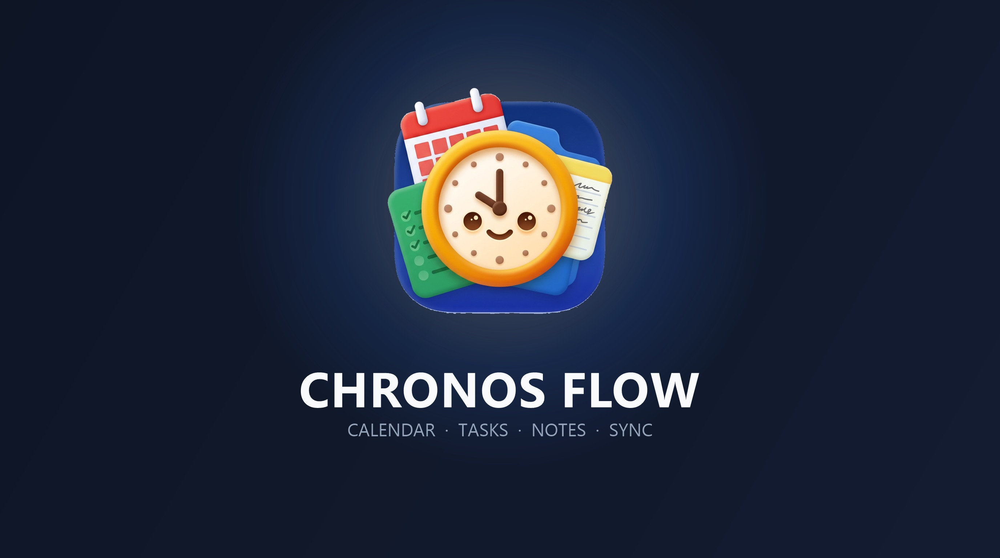

# Chronos Flow 5.10 — Project & People UI PWA



**Chronos Flow** is a local-first enterprise productivity, project management, and team collaboration Progressive Web App (PWA) designed for modern educators, professionals, and distributed teams.

Built with an offline-first architecture, Chronos Flow pairs instant local responsiveness with real-time cloud synchronization via Google Firebase, offering project lifecycle tracking, a Notes-style visual Team Spaces hub, markdown documentation, and calendar scheduling.

---

## ✨ Key Features & Capabilities

### 🏢 Team Spaces Hub (Notes-Style Cards Grid)
- **Vibrant Workspace Cards Grid:** Every collaboration space is represented as an interactive, tactile card inspired by modern note-taking interfaces.
- **Brand Identity & Theming:** Customize each workspace with dedicated emoji avatars and 6 curated brand color themes (Emerald, Indigo, Rose, Amber, Purple, Cyan).
- **Colleague Facepiles & Stats:** Overlapping member avatars and live member/task counters provide at-a-glance visibility into team activity.
- **1-Click Workspace Switching:** Instantly switch between teams and load dedicated directories, tasks, notes, and milestones with zero friction.
- **3-Tab Team Management Suite:** Full modal suite for Workspace Customization, Members & Directory (role management, invite link generation), and Danger Zone (permanent team deletion).

### 🚀 Project Workspace Manager
- **Multi-Phase Project Lifecycle:** Organize workflows across structured milestone phases—*Phase 1: Planning*, *Phase 2: Implementation*, and *Phase 3: Evaluation*.
- **Integrated Deliverables & TA Tracker:** Track project milestones, deadlines, overdue notices, and technical assistance (TA) requirements.
- **Elevated Project Workspace Modal:** Full-featured dialog for editing project parameters, duplicating templates, archiving, and permanent removal.
- **Progress Tracking:** Real-time computation of milestone completion percentages.

### 📝 Keep-Style Notes Studio
- **Rich Markdown Previews:** Formatted headings, task checklists, code blocks, tables, and blockquotes rendered directly on note cards.
- **Palette Theming:** Color-code notes with curated pastel accents (*Coral, Peach, Sand, Mint, Sky, Lavender*).
- **Organization & Search:** Pin critical notes, assign multi-tags, archive completed items, and search across titles and content instantly.

### 📅 Calendar & Timeline Scheduling
- **Flexible Views:** Navigate through Day, Week, and Month perspectives.
- **Milestone & Task Tracking:** Synchronized with personal and team deadlines with visual urgency badges (*Overdue, Due Today, Upcoming*).

### ⚡ Local-First Engine & Cloud Synchronization
- **Offline-First PWA:** Full service worker caching enables complete offline functionality with instant boot times.
- **Firebase Firestore Integration:** Real-time bi-directional synchronization across multiple devices with Google OAuth authentication.
- **Anti-Resurrection Overhaul:** Guaranteed tombstone synchronization preventing deleted items from reappearing during cross-device reconciliations.

### 🎨 3D Infinity Flow Brand System
- **Theme-Aware Topbar Brand:** Dynamic illuminated 3D logo emblems that automatically switch between light and dark variants to match your active UI mode.
- **PWA Asset Suite:** 192×192 and 512×512 bicubic PWA app icons and iOS Apple Touch icons.

---

## 🛠️ Technology Stack

| Layer | Technologies |
| :--- | :--- |
| **Frontend** | Semantic HTML5, Modern CSS3 (Variables, Grid, Flexbox, Glassmorphism), Vanilla JavaScript |
| **PWA & Offline** | Service Worker API (`sw.js`), Web App Manifest (`manifest.webmanifest`), IndexedDB & LocalStorage |
| **Backend & Sync** | Google Firebase Authentication, Cloud Firestore Realtime Database |
| **Design System** | Lucide Vector Icons, Adaptive Light/Dark Mode, Dynamic Accent Palettes |

---

## 🚀 Getting Started & Deployment

### 1. Prerequisites
- A Google Firebase project with:
  - **Firebase Authentication** (Google sign-in provider enabled).
  - **Cloud Firestore Database** (Production or test mode).
- An HTTPS hosting provider (e.g. Firebase Hosting, GitHub Pages, Vercel, Netlify).

### 2. Configure Firebase Security Rules
In your Firebase Console, navigate to **Firestore Database → Rules** and publish the included [`firestore.rules`](file:///firestore.rules):
```javascript
rules_version = '2';
service cloud.firestore {
  match /databases/{database}/documents {
    // Refer to firestore.rules for full collaborative permissions
  }
}
```

### 3. Deploy App Shell
1. Clone or download the repository contents:
   ```bash
   git clone https://github.com/jorzyrockz-crypto/Chronos-Flow.git
   ```
2. Upload all files (`index.html`, `sw.js`, `manifest.webmanifest`, `icons/`) to your HTTPS web host.
3. Add your hosting domain to **Firebase Console → Authentication → Settings → Authorized domains**.
4. Open the deployed application, sign in with your Google account, and your personal and team workspaces will initialize automatically.

---

## 📱 Progressive Web App (PWA) Installation

- **Desktop (Chrome / Edge / Safari):** Click the install icon in the URL omnibox to add Chronos Flow to your applications dock or start menu.
- **iOS / iPadOS:** Open the site in Safari, tap the **Share** button, and select **Add to Home Screen**.
- **Android:** Tap the browser menu and select **Install App** or **Add to Home screen**.

---

## 📄 License & Attribution

Chronos Flow 5.10 is developed for education, team coordination, and productivity. Built with local-first principles.
